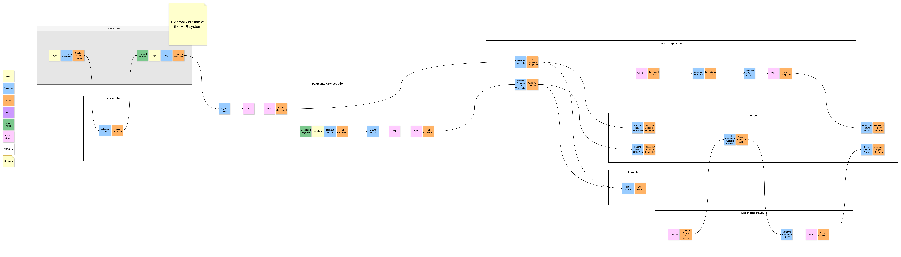
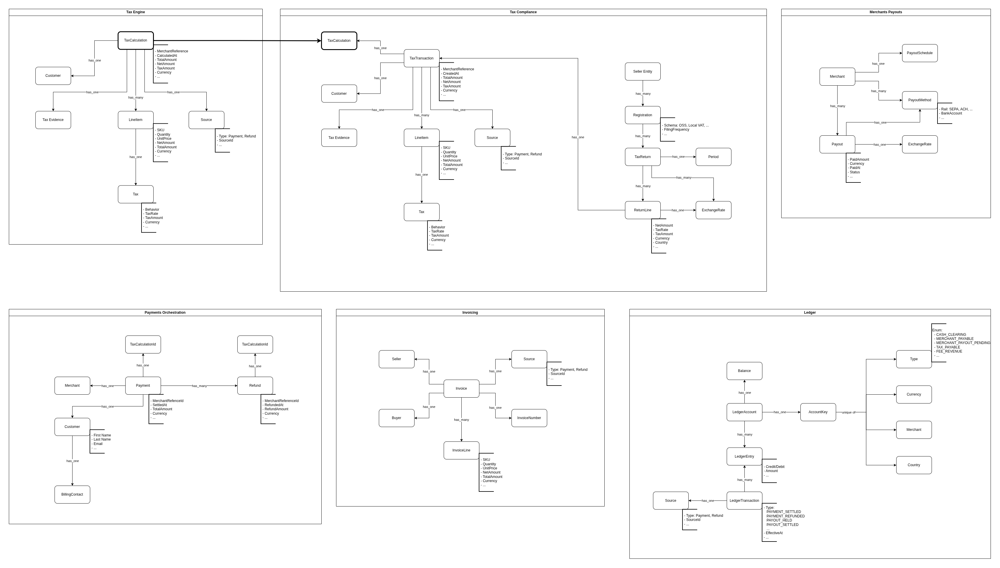
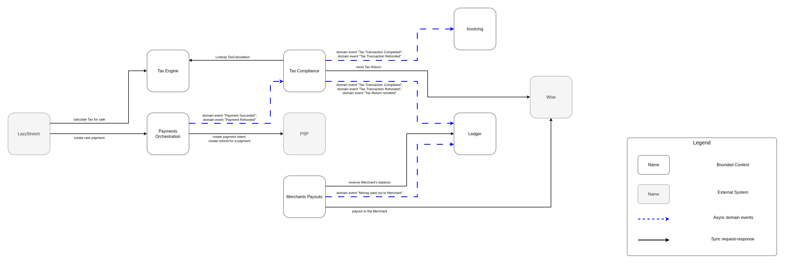
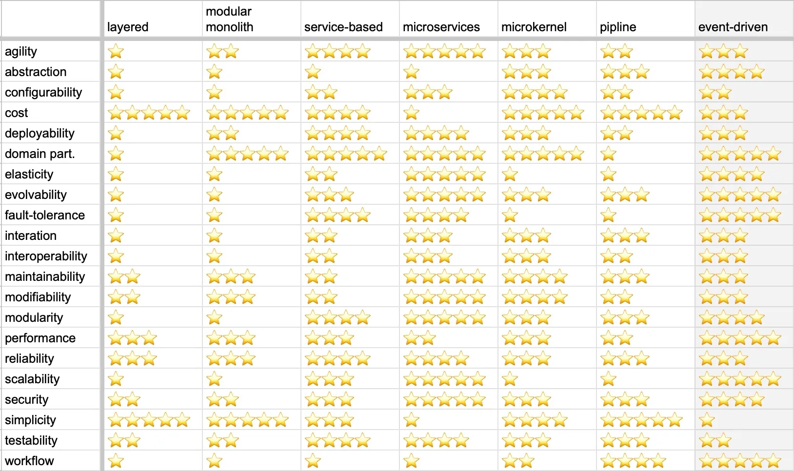
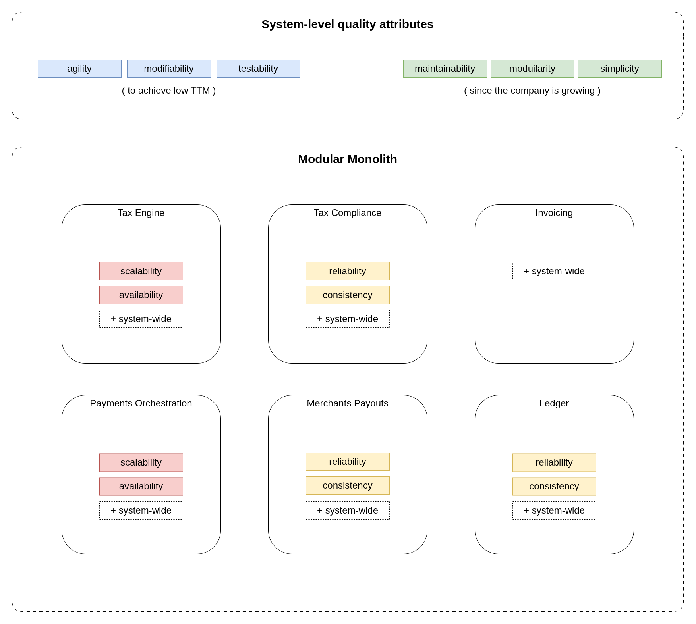
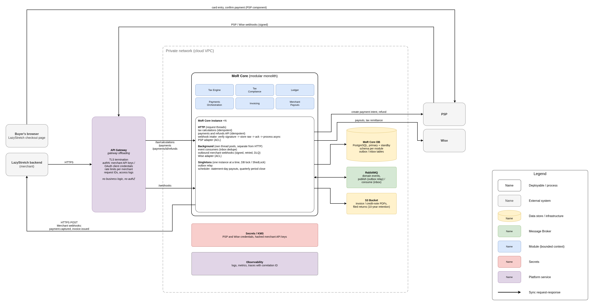

# MoR System Design

## 👥 Merchant

"Lazy Stretch" from 🇺🇸 

- SaaS business selling yoga subscriptions
- Already has a global website and manages users' subscriptions
- Wants to sell in the EU without worrying about compliance or payment processing

## ✍️ Task

Design a system that supports the merchant through our MoR infrastructure.  

We have:
- Legal entity in Netherlands
- PSP account
- Wise account

## Requirements

### Main scenarios that we must support

1. EU Buyer purchases the yoga subscription from the Lazy Stretch website.
    - The Buyer goes through the checkout process at Merchant's website
    - MoR is responsible for calculating taxes for the Buyer's purchase
    - MoR is responsible for collecting money from the Buyer
    - The settled payment is registered in the ledger
    - The same settled payment is stored as a taxable transaction, for the tax return
    - MoR is responsible for issuing the invoice for the Buyer's purchase

2. On subscription renewal (or at another billing event) the Recurring Fee must be charged to the Buyer.
    - The Merchant manages the subscription and its billing cycles
    - The Merchant initiates charging the recurring fee for the subscription
    - MoR is responsible for calculating taxes and collecting money
    - The settled payment is registered in the ledger
    - The same settled payment is stored as a taxable transaction, for the tax return
    - MoR is responsible for issuing the invoice

3. Merchant-initiated refund
    - The Merchant can find previously completed transactions and choose one for refund
    - The Merchant creates the refund request
    - MoR is responsible for processing the refund through the PSP
    - The processed refund is registered in the ledger
    - The same refund is stored as a tax transaction, for the tax return
    - MoR is responsible for issuing the refund invoice

4. On the Merchant's statement day, the proceeds must be paid out to the Merchant
    - MoR obtains the Merchant's balance from the ledger
    - Proceeds are paid out to the Merchant's USD account through our Wise account
    - Successful payout is recorded in the ledger, updating the Merchant's balance

5. After the tax period ends, MoR must file and remit the taxes for the sales within that period
    - At period end, taxable transactions are added up per country and optionally rated, to prepare the tax return
    - MoR is responsible for filing EU taxes with the authorities
    - Taxes are remitted from the MoR account, and the remittance is recorded in the ledger

### Context implications

1. According to the EU legislation, the MoR platform for digital sales in the EU is the supplier for VAT.  
    (Implementing Regulation 282/2011, Art. 9a, VAT Directive 2006/112/EC, Art. 28 and Art. 14)

2. The MoR platform owes VAT in each customer's member state. (VAT Directive Art. 58)  
    VAT rates vary across EU member states (19% in Germany, 20% in France, 24% in Greece).  
    However, VAT Directive Art. 358-369 let the MoR file and pay all EU VAT through a single member state instead of registering in each one (OSS scheme).

3. Some EU member states have a national currency other than EUR (Czechia, Denmark, Hungary, Poland, Romania, Sweden).  
    This means that we may (or may not) collect payments from Buyers in different currencies, but we need to pay out to the Merchant in USD.

### Out of scope - assumptions

- "Lazy Stretch" already has a global website - let's assume that they already have the checkout page there.
- "Lazy Stretch" manages users' subscriptions - therefore, our MoR system does not do it, we can only react to certain events / API calls.
- Catalog of items with unit prices, discounts are out of scope. It is expected that we get this information with the requests.

## MoR System Design

### Sequence Diagrams

The diagrams were created to represent the scenarios mentioned in the Requirements section above.  
The goal for these diagrams was to understand the process *in general*, without going too much into details.  
Therefore, *internal* components of the MoR platform are (mostly) not represented there.

They are moved to a separate file to save space in the main document: [diagrams here](sequence-diagrams.md)  

### Event Storming & Bounded Contexts

[EventStorming](https://www.eventstorming.com/) is a workshop format that helps explore complex business domains.  
The goal of this workshop is to represent business processes in the system as a series of domain events.

In the diagram below I've tried to express the scenarios from the Requirements section:

- Calculating taxes for the sale and processing a payment
- Creating refunds for the completed payments
- Recording payments/refunds for the further tax returns
- Recording committed transactions as the ledger entries
- Merchant payouts and tax returns
- Issuing invoices to the buyers

The stickers are grouped into **Bounded Contexts**.  
The division isn't final - it's just my attempt, based on what came to mind while working on the diagram.  
A real SME may break the MoR system down differently.

This diagram helps to:
1) Represent an attempt to break down the system into Bounded Contexts,
2) Show communications (essentially, coupling) between them, based on the business processes (system behavior, or *function*).

#### Bounded Contexts decisions

- **Tax Engine** is extracted into a separate Bounded Context.
    - In one of the first attempts to group the stickers, I placed the Tax Calculation stickers in the same group as the rest of the tax-related stickers (Tax Compliance).
    - Later, I realized that these groups of stickers represent different business logic, involved in separate business processes (calculating tax for a sale vs. tax returns). They may also have different quality attributes (more on that later in the document): tax calculation is part of the checkout flow, while tax returns happen on a schedule. So I concluded that it makes sense to decouple them.

- **Payments Orchestration** context is responsible for purely orchestrating payments and refunds through the PSP.
    - Its main purpose is to send requests to the PSP to charge or refund the Total Amount, previously calculated by the Tax Engine and provided directly in the request. Charging or refunding money through the PSP does not require the full breakdown of line items into net/tax/total amounts. This is why it is decoupled from the calculation logic and data structures.
    - It also receives webhooks from the PSP and signals (publishes events) when a payment or refund has been processed on the PSP side. At that point, the money transfer can be considered a fulfilled fact, and other parts of the system can react to these events asynchronously.

- **Tax Compliance** Bounded Context is responsible for recording the fulfilled facts.
    - Its main purpose is to consume the event from the **Payments Orchestration** context, and record that the corresponding `TaxCalculation` can be converted into a completed `TaxTransaction`.
    - When a `TaxTransaction` is recorded, a corresponding business event is published. This event contains the full breakdown of line items, so other contexts (**Ledger** and **Invoicing**) can act upon it.
    - At the end of the tax period, `TaxTransactions` are used to collect the Tax Return lines to be submitted to the authorities.

- **Ledger** listens to events from **Tax Compliance** for the reason described above: those events should have all of the needed data within the event payload.
    - From a business perspective, it would be more correct for the **Ledger** to listen to events from **Payments Orchestration**. If at some point it becomes clear that those events carry enough data, we should switch to that.
    - The ledger also records transactions for remitted taxes and merchant payouts.

- **Merchants Payouts** is responsible for the business process of paying out proceeds to merchants.
    - In order to make a payout, we need to put the merchant's current available balance on hold, otherwise a concurrent transaction (a refund, for example) may get lost. To do this, there is a communication from the **Merchants Payouts** to the **Ledger** context - and this communication must be of a *strong* consistency type (meaning, it must be synchronous), which will put the available balance from the `MERCHANTS_PAYABLE` into the `MERCHANTS_PAYOUT_PENDING` ledger account.

- **Invoicing** is the Bounded Context responsible for generating and issuing the documentation for the Buyers.
    - For example, document numbers must be sequential and traceable.
    - The PDFs can be uploaded to a publicly available S3 bucket, or a similar object storage.

### Conceptual Data Model

It is in fact conceptual - its goal is to show the main domain entities that a certain Bounded Context requires for its business logic.  
This diagram is **not** intended to represent the actual DB schema - it lacks many of the technical aspects (ids, timestamps, foreign keys, indexes, etc).
The main goal is, again, to represent communications - this time based on the data structures (system *form*).

In my example there are almost no communications between contexts at the data model level.  
Mostly because I suppose that enough information can be transmitted in the payload of the business events, and a separate data model streaming is not necessary here, especially with the chosen architectural style (more on that below).  

The only data structure that needs to get across context boundaries is `TaxCalculation`.  
When **Payments Orchestration** publishes the "Payment Captured" event, it provides the `taxCalculationId` that was used to create this payment. The **Tax Compliance** context then needs to request the calculation from the **Tax Engine** context to convert it into a transaction.  

### Communications Diagram

This diagram combines communications from the Event Storming diagram, and the Conceptual Data Model, and focuses on the communications.

All communications can be divided by the *consistency type*: *strong* consistency vs *eventual* consistency.  

Asynchronous communications (that have *eventual* consistency type) typically help to improve the system's performance, scalability, availability, and lower coupling between Bounded Contexts - this is why I've tried to choose them where applicable.

The only communication that requires **strong** consistency is the request from **Merchants Payouts** to the **Ledger** to reserve the Merchant's balance for the payout.

The communication to "Lookup TaxCalculation objects" would normally be asynchronous data streaming - but taking into account the modelled load for the system I decided to just request it synchronously. If we had chosen to stream all of the calculations, we would have a lot of unused calculations streamed into other Bounded Contexts, because not all of the calculations will actually be paid for.

### Quality Attributes & Architectural Style

Quality Attributes are architectural characteristics that a system (or an individual Bounded Context) may have.  

If a particular Bounded Context requires quality attributes different from other contexts (for example, an asymmetrically higher load, which means higher scalability/elasticity requirements), this may be a signal to extract it into a separate service (deployable).

Below is a list of quality attributes that I've chosen for the system, and their definitions from Arc42:

[https://quality.arc42.org/qualities/](https://quality.arc42.org/qualities/)

#### Definitions of the selected quality attributes

| Quality Attribute | Definition |
|---|---|
| [**Agility**](https://quality.arc42.org/qualities/agility) | A system can rapidly be changed (as opposed to flexibility, which means that a system can easily be changed.) |
| [**Availability**](https://quality.arc42.org/qualities/availability) | Capability of a product to be accessible and operational when required for use.   Essentially, information and systems should be up and running when needed. |
| [**Testability**](https://quality.arc42.org/qualities/testability) | Capability of a product to enable an objective and feasible test to be designed and performed to determine whether a requirement is met. |
| [**Modularity**](https://quality.arc42.org/qualities/modularity) | Capability of a product to limit changes to one component from affecting other components.   Modularity implies that the product will be composed of discrete modules or components with cohesive content and minimal coupling to other modules or components. |
| [**Maintainability**](https://quality.arc42.org/qualities/maintainability) | Maintainability is concerned with modifications after the software baseline is established.   The goal of a maintenance activity is to correct defects, adapt to changing environments, or improve a system's future maintainability or other quality attributes. |
| [**Modifiability**](https://quality.arc42.org/qualities/modifiability) | Capability of a system to be effectively and efficiently modified without introducing defects or degrading existing product quality |
| [**Reliability**](https://quality.arc42.org/qualities/reliability) | Capability of a product to perform specified functions under specified conditions for a specified period of time without interruptions and failures. |
| [**Scalability**](https://quality.arc42.org/qualities/scalability) | Capability of a product to handle growing or shrinking workloads or the ease with which the product's capacity can be adapted to handle variability |
| [**Simplicity**](https://quality.arc42.org/qualities/simplicity) | For software, "simple" means easy to read, understand, and correctly modify. |

Why these quality attributes:
- By improving **agility**, **modifiability**, **testability** of the system we can lower the TTM of our features
- Higher **maintainability**, **modularity**, **simplicity** help to prove business hypotheses faster, and discard them with less impact on the system.

Here is a comparison chart of architectural styles and their quality attributes:  
*Sorry for the typos in the image, the picture is not mine >.<*

#### Modelled load profile

For one Merchant "Lazy Stretch":

- 50k EU subscribers on monthly plans
    - ~2k payments a day (1.7k renewals, 150 new, retries).
    - ~2.5k tax calcs a day, +15k HTTP requests, 12k events.
        - 0.2 requests per second on average, ~10 per second at peak (nightly renewal batch, January sign-ups).

#### System Architectural Style

Mapping of the quality attributes to our Bounded Contexts:

For the overall system I've chosen **Modular monolith**:
- It has good values for **maintainability** and **modifiability**, with great **simplicity** and lowest **cost**.
- The modelled load profile allows us to start with a **modulith**, and if the context boundaries are drawn correctly, it will be possible to migrate to **microservices** later when the load increases.
- Most likely, the team working on the system will be small (at least at first), and microservice architecture will not pay off from the start.

If the modelled load profile is close to reality, then:
- Below about 200 merchants (under 500k calcs a day, about 30 per second at peak) there is no load reason to split.
- Between 1,000 and 2,000 merchants, watch the Tax Calculation p99 latency and decide on the split.

## Deployment Diagram

## Implementation Details

### Event delivery (no broker)

- The event is written to the module's `outbox` table in the same DB transaction as the state change.
- A singleton outbox relay (DB lock) delivers events in-process to subscribers; each handler runs in its own transaction.
- The relay, retries and dead-letter handling come from a proven library (framework outbox support or a Postgres-backed queue), not hand-written code.
- At-least-once delivery, ordered per aggregate (payment ID, payout ID); retries with backoff, then a dead-letter table and an alert.
- Events carry an event ID, a schema version and a correlation ID; fields are only added, never changed.
- After a split, the relay publishes to Kafka/RabbitMQ instead; the outbox, inbox and event contracts stay the same.

### Idempotency

- Merchant API: `Idempotency-Key` per merchant (stored response + request hash, kept for 24 h).
- Business guards: one payment per `calculationId`; refunds ≤ captured amount (payment row locked).
- PSP and Wise calls use our own IDs as idempotency keys; on a timeout, check the status, never retry blindly.
- Webhooks: unique `(provider, provider_event_id)`, so duplicates are dropped.
- Internal events: inbox table per module, `(consumer, event_id)` primary key.
- One `TaxTransaction`, `LedgerTransaction` and `Invoice` per source ID (unique constraints).
- State transitions guarded by the expected current state, so late or duplicate webhooks do nothing.
- Scheduled jobs keyed by `(merchant, statement date)` and `(registration, period)`.

### Ledger internals

- Double-entry: debits = credits per currency, checked on every post.
- Append-only: no `UPDATE`/`DELETE` grants; corrections are reversal entries.
- Amounts as integer minor units with a currency; the Ledger never rounds, it posts the tax snapshot amounts.
- Accounts keyed by `(Type, Currency, Merchant, Country)`; entries dated by when the money moved, not the tax point.
- Balances derived from entries; the cached balance row is updated in the same transaction and checked nightly.
- Reserve for payout: one DB transaction with `SELECT ... FOR UPDATE` on the merchant's balance row, so concurrent refunds and payouts are serialized.

### Data ownership and retention

- One schema and one DB role per module; no cross-schema reads or foreign keys.
- Modules talk only through module APIs and events; events carry snapshots.
- 10-year retention for tax transactions, evidence, returns, invoices and the ledger (OSS, VAT Directive Art. 369).
- Unpaid tax calculations kept for 90 days (monthly partitions, then dropped).
- Invoice PDFs and filed returns in object storage with Object Lock.
- Buyer personal data kept in a few known places only (Tax Engine, Tax Compliance, Payments, Invoicing); none in logs.
- GDPR erasure: immediately delete what isn't legally required; tax records stay until their retention ends.

### Security

- Gateway: TLS, authN (API keys / OAuth client credentials), rate limits per merchant; MoR Core accepts traffic only from the gateway.
- AuthZ in the modules: every query is scoped by the merchant ID from the auth context.
- Amounts always come from our own `TaxCalculation`; a signed quote token (JWS + JWKS) is needed only after the Tax Engine split.
- Inbound webhooks authenticated by provider signature; outbound webhooks signed with HMAC per merchant.
- PCI SAQ A: card entry happens in the PSP component.
- Secrets in KMS; merchant API keys hashed; encryption at rest and in transit.
- Invoice PDFs in a private bucket, shared through short-lived pre-signed URLs.
- Back-office access through SSO + MFA, with an audit log.
