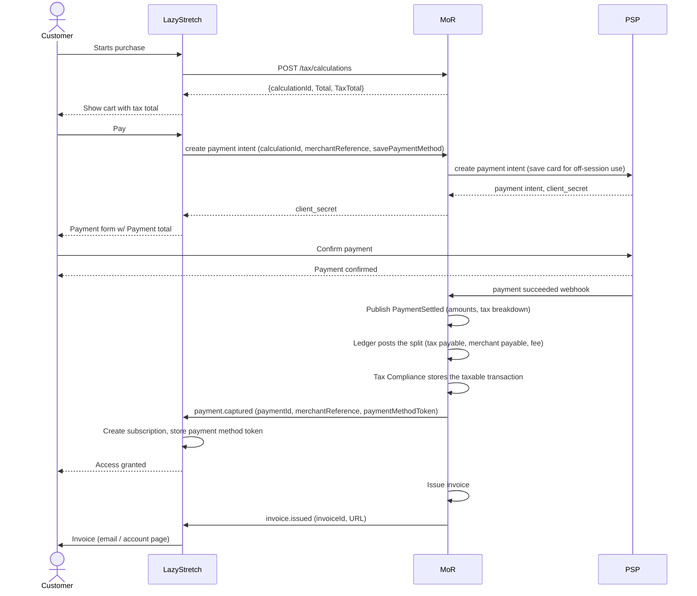
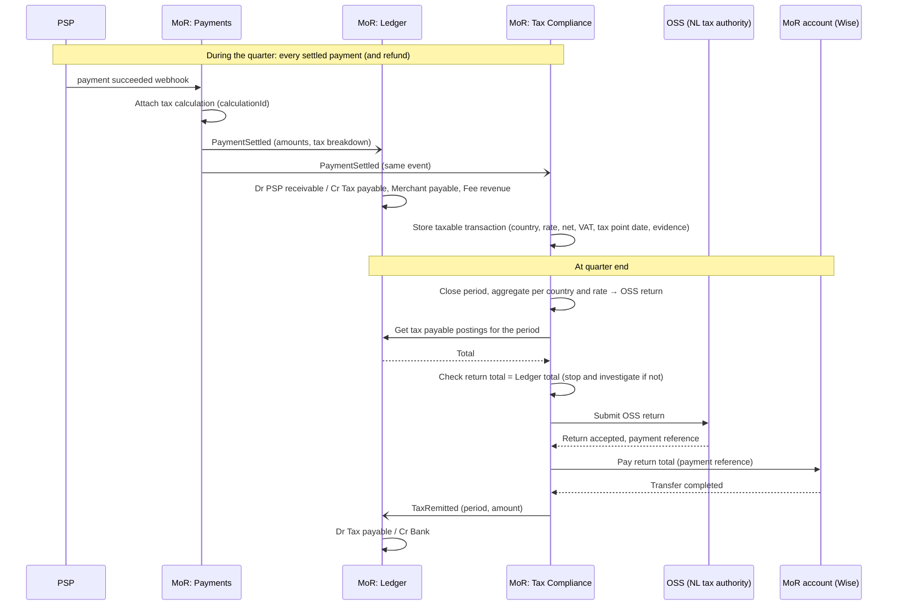

## **👥** Merchant

“Lazy Stretch” from 🇺🇸 

- SaaS business selling yoga subscriptions
- Already has a global website and manages users’ subscriptions
- Wants to sell in the EU without worrying about compliance or payment processing

## ✍️ Task

Design a system that supports the merchant through our MoR infrastructure.  

We have:
- Legal entity in Netherlands
- PSP account
- Wise account

## Main scenarios that we must to support

1. EU Buyer purchases the yoga subscription from the Lazy Stretch website.
    - MoR is responsible for calculating taxes, by identifying Buyer's location
    - MoR is responsible for collecting money from the Buyer
    - The settled payment is registered in the Ledger
    - The same settled payment is recorded by Tax Compliance as a taxable transaction, for the tax return (scenario 4)
    - MoR is responsible for issuing the invoice for the Buyer's purchase

2. On subscription renewal (or at another billing event) the Recurring Fee must be charged from the Buyer.
    - MoR is responsible for calculating taxes and charge the stored payment method (PSP Token)
    - The settled payment is registered in the Ledger
    - The same settled payment is recorded by Tax Compliance as a taxable transaction, for the tax return (scenario 4)
    - MoR is responsible for issuing the invoice

3. On the Merchant's statement day, the proceeds must be paid out to the Merchant
    - MoR obtains the Merchant's balance from the Ledger
    - Proceeds are paid out to Merchant's USD account

4. In accordance with the EU Tax legislation, MoR must file and remit the taxes for the sales within the tax period (e.g. quarterly).
    - Tax Compliance subscribes to the same settled-payment and refund events as the Ledger, and keeps its own record of every taxable transaction (country, rate, net, VAT, tax point date, location evidence)
    - At period end, Tax Compliance adds up those records per country and rate to prepare the OSS return
    - Before filing, the return total is checked against the Ledger's tax payable postings for the period; they must match
    - MoR files all of the EU-taxes through the OSS
    - Taxes are remitted from the MoR account, and the Ledger posts the remittance (tax payable → bank)

5. Merchant-initiated refund

6. Buyer or card issuer initated chargeback / withdrawal

## Important assumptions

- "Lazy Stretch" already has a global website - let's assume that they already have the checkout page there.
- "Lazy Stretch" manages users' subscriptions - therefore, our MoR system does not do it, we can only react to certain events / API calls.
- Similarly, our MoR system does not provide the catalog of items and their unit prices, discounts. It is expected that we get this information with the requests.

## Sequence Diagrams

### Scenario 1: EU Buyer purchases the yoga subscription

### Scenario 4: File and remit EU taxes for the quarter

The Ledger and Tax Compliance consume the same event; neither reads its data from the other. The Ledger knows the total tax we hold; Tax Compliance knows what it is made of (per country and rate) and can prove it. They meet once per period, in the check before filing.

## Event Storming

## Conceptual Data Model ?

## Structural Diagram

## Architectural Style

