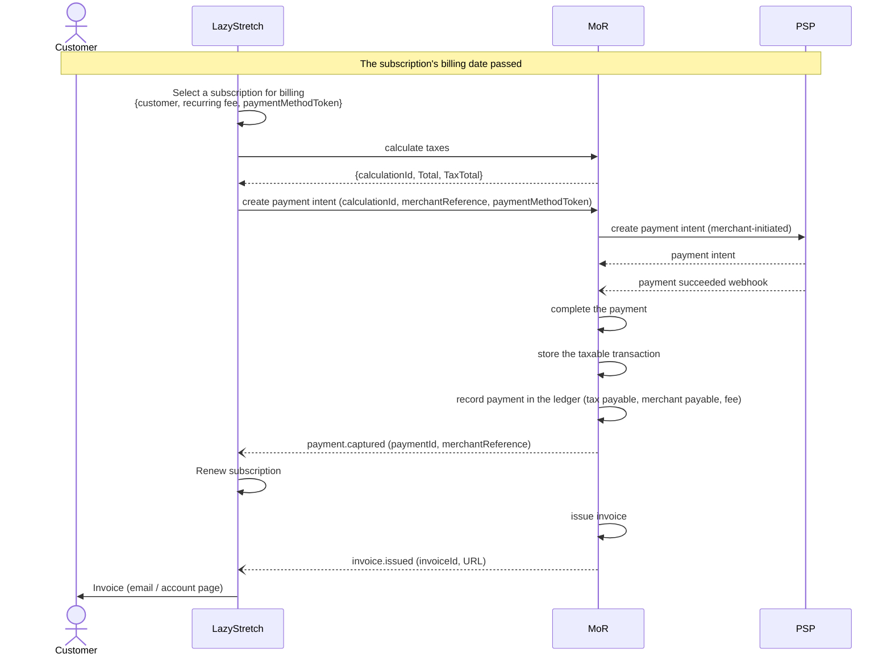
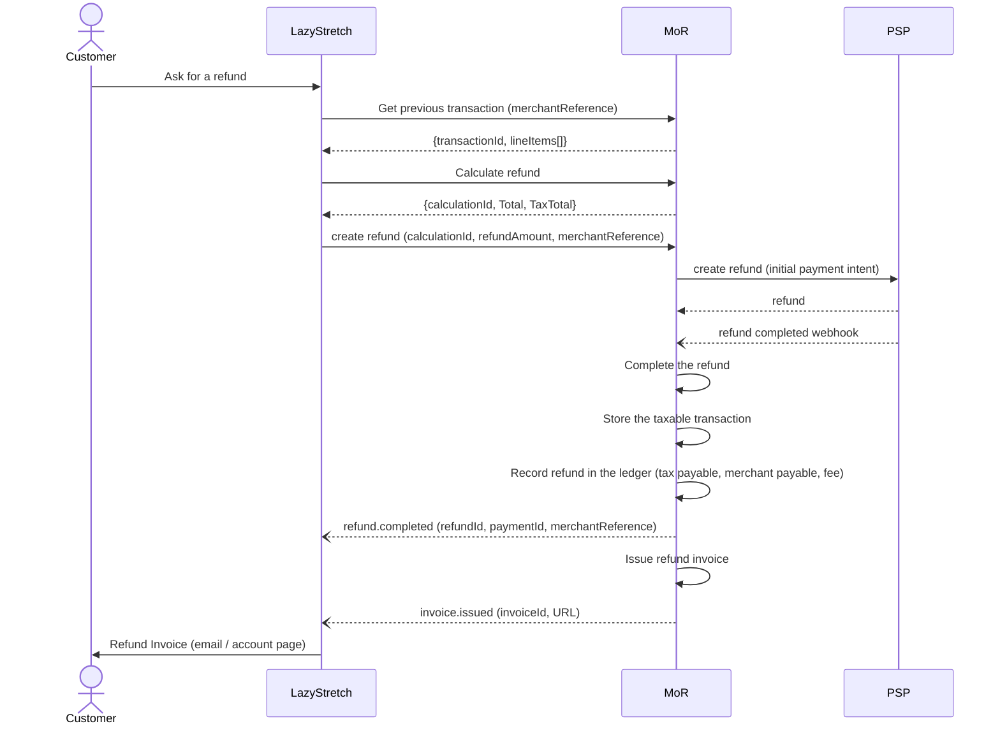
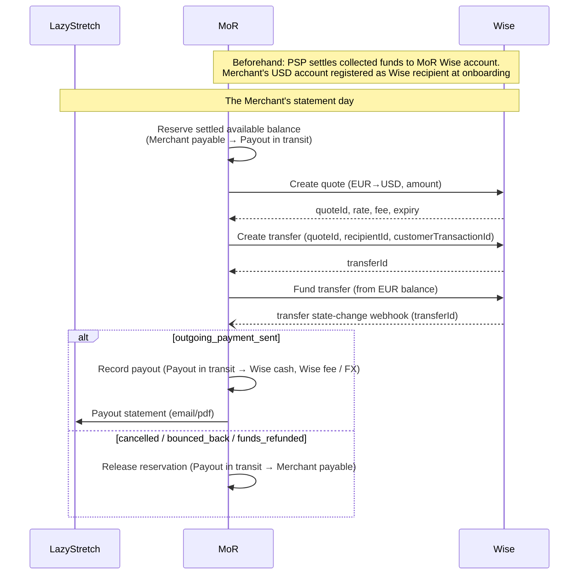
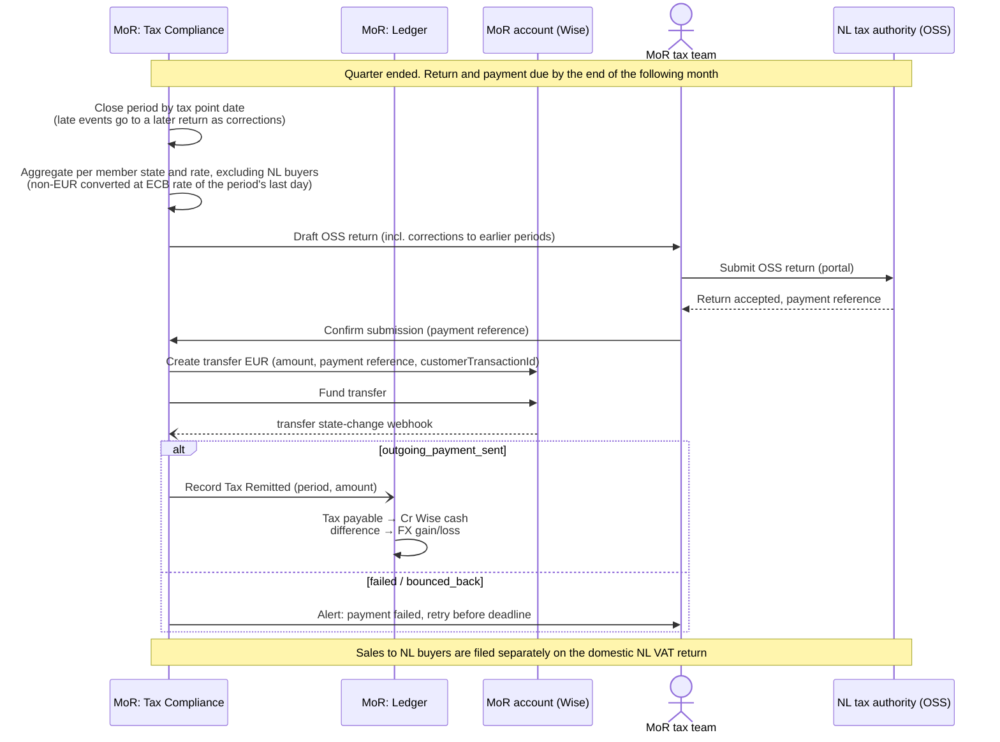

# Sequence Diagrams

## Scenario 1: EU Buyer purchases the yoga subscription

- The Buyer goes through the checkout process at Merchant's website
- MoR is responsible for calculating taxes for the Buyer's purchase
- MoR is responsible for collecting money from the Buyer
- The settled payment is registered in the ledger
- The same settled payment is stored as a taxable transaction, for the tax return
- MoR is responsible for issuing the invoice for the Buyer's purchase

```mermaid
sequenceDiagram
    actor Customer
    participant LazyStretch
    participant MoR
    participant PSP

    Customer->>LazyStretch: Starts purchase
    LazyStretch->>MoR: POST /tax/calculations
    MoR-->>LazyStretch: {calculationId, Total, TaxTotal}
    LazyStretch-->>Customer: Show cart with tax total
    Customer->>LazyStretch: Pay
    LazyStretch->>MoR: create payment intent (calculationId, merchantReference, savePaymentMethod)
    MoR->>PSP: create payment intent (save card for off-session use)
    PSP-->>MoR: payment intent, client_secret
    MoR-->>LazyStretch: client_secret
    LazyStretch-->>Customer: Payment form w/ Payment total
    Customer->>PSP: Confirm payment
    PSP-->>Customer: Payment confirmed

    PSP--)MoR: payment succeeded webhook
    MoR->>MoR: Complete the payment
    MoR->>MoR: Store the taxable transaction
    MoR->>MoR: Record payment in the ledger (tax payable, merchant payable, fee)
    
    MoR--)LazyStretch: payment.captured (paymentId, merchantReference, paymentMethodToken)
    LazyStretch->>LazyStretch: Create subscription, store payment method token
    LazyStretch-->>Customer: Access granted

    MoR->>MoR: Issue invoice
    MoR--)LazyStretch: invoice.issued (invoiceId, URL)
    LazyStretch->>Customer: Invoice (email / account page)
```

## Scenario 2: On subscription renewal (or at another billing event) the Recurring Fee must be charged to the Buyer

- The Merchant manages the subscription and its billing cycles
- The Merchant initiates charging the recurring fee for the subscription
- MoR is responsible for calculating taxes and collecting money
- The settled payment is registered in the ledger
- The same settled payment is stored as a taxable transaction, for the tax return
- MoR is responsible for issuing the invoice

## Scenario 3: Merchant-initiated refund

- The Merchant can find previously completed transactions and choose one for refund
- The Merchant creates the refund request
- MoR is responsible for processing the refund through the PSP
- The processed refund is registered in the ledger
- The same refund is stored as a tax transaction, for the tax return
- MoR is responsible for issuing the refund invoice

## Scenario 4: Payout to the Merchant

- MoR obtains the Merchant's balance from the ledger
- Proceeds are paid out to the Merchant's USD account through our Wise account
- Successful payout is recorded in the ledger, updating the Merchant's balance

## Scenario 5: File and remit EU taxes for the quarter

- At period end, taxable transactions are added up per country and optionally rated, to prepare the tax return
- MoR is responsible for filing EU taxes with the authorities
- Taxes are remitted from the MoR account, and the remittance is recorded in the ledger

